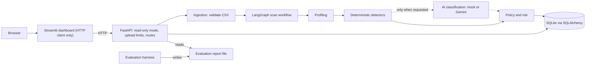

# VerityGrid

**AI-assisted data governance and reliability workbench.** Upload a CSV, profile every column, find data-quality and privacy risks with transparent deterministic rules, optionally ask a language model for an *advisory* sensitivity label, and route every finding through human review with an audit trail.

> VerityGrid is an independent portfolio prototype. It uses **synthetic data only**, is not affiliated with Sysco or Sysco LABS, and is **not** a security, compliance or production-ready product. Read [Limitations](#limitations) and [SECURITY.md](SECURITY.md) before running it anywhere other people can reach.

## Status at a glance

| Area | State |
|---|---|
| Backend, workflow, dashboard, evaluation harness | Implemented and tested: more than 1,300 automated tests passed on the author's Windows machine (last full run 2026-11-25; one known third-party deprecation warning). |
| Read-only demo in Docker | Built and run by the author with `docker compose`: API healthy, seeded data served (3 datasets, 12 findings, 2 example reviews), uploads refused with HTTP 403. The image also carries a committed snapshot of the real-model evaluation run. |
| Real-model evaluation | **Run once** (2026-11-19), a single, non-reproducible run of `gemini-3.5-flash-lite`: accuracy 0.794 (50 of 63 columns), 60 of 63 columns answered (0.833 over the answered ones). **Not distinguishable** from the keyword mock (0.698) on this small, same-author dataset. See [docs/EVALUATION.md](docs/EVALUATION.md). |
| Public deployment | **Deployed on 2026-11-26** to Render's free plan as a **read-only** demo of synthetic data (uploads, scans and reviews are disabled): dashboard <https://veritygrid-ui.onrender.com>, API documentation <https://veritygrid-api.onrender.com/docs>. Built from commit `014506f`. Free services sleep after 15 minutes without traffic and need about a minute to wake; open the API's `/health` first. Availability is not guaranteed. See [docs/DEPLOYMENT.md](docs/DEPLOYMENT.md). |
| Authentication | **None.** Uploads and reviews are open in development mode and disabled in demo mode. |

## What it does

1. **Ingests** a UTF-8 CSV safely: size, row and column limits, malformed-file rejection, nothing written to disk.
2. **Profiles** every column: inferred type, row count, null share, distinct share.
3. **Detects** six kinds of issue with deterministic rules (no model involved):

   | Category | Rule (defaults) |
   |---|---|
   | `missing_values` | Reported at 20% missing or more; severity low below 25%, medium from 25%, high from 50%. |
   | `duplicate_rows` | Repeated rows; high when 10% or more of rows are affected, otherwise medium. |
   | `potential_email` | Email-shaped values in text columns; high when at least half the values match. |
   | `potential_phone` | North American phone formats in text columns; same banding. |
   | `numeric_rule_violation` | Values outside bounds you configure (only on columns named in the upload's rules). |
   | `invalid_date` | Values that do not parse under a date format you configure (same). |

   The first four run by default. Numeric and date rules need **detection rules**: an optional JSON `rules` field on `POST /scans`, or the rules box in the dashboard's Upload view. Rules are validated (size, entry caps, an allowlist for date formats, column names that must exist in the file), apply to that one scan and are not stored. Findings store counts and rule names, **never cell values**.
4. **Optionally classifies** each column as `public`, `internal`, `personal`, `financial` or `unknown`. The default provider is an offline keyword **mock**, not a language model. A Google Gemini adapter is available when configured. Only sanitized column metadata is ever sent (never cell values), the answer is validated against a strict schema, a policy layer can only *raise* review requirements, and results are labelled unverified. Uploads through the HTTP API never request classification.
5. **Orchestrates** the steps as a bounded LangGraph workflow with fatal and non-fatal steps, a column cap and a circuit breaker.
6. **Persists** datasets, scans, column profiles, findings, review decisions and audit events in SQLite through SQLAlchemy.
7. **Lets humans decide.** Findings start as `pending`. A reviewer approves or rejects each one; history is append-only and every decision writes an audit event. A review never changes or deletes data.
8. **Shows it** in a Streamlit dashboard that talks to the API over HTTP only.
9. **Measures itself** with a reproducible evaluation harness on a fixed, labelled, synthetic dataset, plus a paced command for a real-model run.

## Architecture



The dashed path is not reachable over HTTP: `POST /scans` never requests classification. The full architecture, with the workflow, the upload sequence and the access modes, is in [docs/ARCHITECTURE.md](docs/ARCHITECTURE.md).

## Prerequisites

- **Python 3.14** (developed on 3.14.2; other versions are untested).
- **Docker** (optional): for the containerised read-only demo.
- **A Gemini API key** (optional): only for the real-model provider and the paced evaluation command. Everything else works without it.
- Commands below are for Windows PowerShell. On macOS or Linux, create and activate the environment with `python3 -m venv .venv` and `source .venv/bin/activate`; the rest is the same (the project has only been run on Windows and in a Linux container).

## Quick start A: the read-only demo in Docker

This is the safest way to look at the project. It needs no Python setup and no secrets.

```powershell
docker compose up --build
```

Then open the dashboard at <http://127.0.0.1:8501> and the API documentation at <http://127.0.0.1:8000/docs>. Both ports are bound to your machine only. Stop with `Ctrl+C`, then `docker compose down`.

The image seeds itself at build time with the three synthetic CSV files, applies sample detection rules to the inventory file so all six detectors are exercised (3 datasets, 12 findings, 2 example review decisions), and installs a committed snapshot of the real-model evaluation as its report. Uploads, scans and reviews are disabled: they answer HTTP 403 `read_only_mode`.

## Quick start B: local development

```powershell
python -m venv .venv
.\.venv\Scripts\Activate.ps1
pip install -r requirements.txt
Copy-Item .env.example .env
```

Edit `.env` and set `VERITYGRID_MODE=development` so uploads and reviews work locally. Leave `AI_PROVIDER=mock`. **Never commit `.env`.**

Start the API and the dashboard in two terminals (activate the environment in each):

```powershell
uvicorn app.main:app --reload
```

```powershell
streamlit run ui/streamlit_app.py --browser.gatherUsageStats false
```

Open <http://localhost:8501>. In development mode the API logs a warning that writes are open to anyone who can reach it; use it for local work only. The API does not reload when `.env` changes, so restart it after editing.

### Running the read-only demo without Docker

```powershell
python -m scripts.seed_demo
$env:DATABASE_URL = "sqlite:///./veritygrid_demo.db"
$env:VERITYGRID_MODE = "demo"
uvicorn app.main:app
```

In demo mode the API refuses to start if the SQLite file named by `DATABASE_URL` does not exist (so a wrong path cannot silently create an empty demo). `python -m scripts.seed_demo --reset` recreates the demo database; it only deletes a SQLite file whose name contains "demo".

## Configuration

All variables are optional. Real environment variables take precedence over `.env`. The template is [.env.example](.env.example); it contains no secrets.

| Variable | Default | Purpose |
|---|---|---|
| `VERITYGRID_MODE` | `demo` | `demo` = read-only API (the default, also used for a missing or invalid value). `development` = uploads, scans and reviews are open. **Not authentication.** Refused (demo is used) when `ENVIRONMENT` is `production` or `prod`. |
| `ENVIRONMENT` | `development` | A label shown by `/health`; also guards the mode above and switches `DEBUG` off. |
| `DEBUG` | `false` | `true` writes tracebacks to the local log; exception text can contain data values. Ignored when `ENVIRONMENT` is production. |
| `DATABASE_URL` | `sqlite:///./veritygrid.db` | SQLAlchemy URL. Tables are created at startup; there is no migration tool. |
| `MAX_UPLOAD_BYTES`, `MAX_UPLOAD_ROWS`, `MAX_UPLOAD_COLUMNS` | 5 MiB, 50,000, 200 | Upload limits. |
| `AI_PROVIDER` | `mock` | `mock` (offline placeholder) or `gemini`. |
| `GEMINI_API_KEY`, `GEMINI_MODEL` | unset | Needed only for `gemini`. The model ID has no built-in default. Keep the key in your local `.env` only. |
| `GEMINI_TIMEOUT_SECONDS`, `GEMINI_MAX_ATTEMPTS` | 20, 2 | Provider timeout (1 to 120) and attempts (1 to 3). |
| `VERITYGRID_API_URL` | `http://127.0.0.1:8000` | Where the dashboard server finds the API. |
| `VERITYGRID_CONNECT_TIMEOUT_SECONDS`, `VERITYGRID_READ_TIMEOUT_SECONDS` | 3, 30 | Dashboard HTTP timeouts. |

The dashboard reads only `VERITYGRID_*` variables, so backend secrets are never loaded into it.

## Tests

```powershell
python -m pytest -q
```

The suite (more than 1,300 tests) covers ingestion, profiling, detectors, the detection rules, the workflow, the AI layer with fake providers, the API, the dashboard client and its static rules, the evaluation harness and the paced real-model command, the security controls and the packaging and documentation files. It makes **no network calls**: AI tests use fakes and the evaluation tests clear the Gemini variables. A project-root `conftest.py` runs the suite in development mode. The only warning is a known deprecation inside the `google-genai` package. Run commands one at a time.

## API

Interactive documentation is served at `/docs` (Swagger UI), `/redoc` and `/openapi.json`; they are public in every mode.

| Method and path | Purpose |
|---|---|
| `GET /health` | Liveness, app name and environment. |
| `POST /scans` | Upload a CSV (multipart field `file`, optional `dataset_name`, optional `rules`: a JSON object with detection rules for this scan) and run a scan. 201 with a safe summary. **Disabled in demo mode.** |
| `GET /scans/{id}` | A scan's status and safe summary. |
| `GET /datasets`, `GET /datasets/{id}` | List and read datasets. |
| `GET /datasets/{id}/columns` | Column profiles (and any stored classification label, source and explanation). |
| `GET /findings` | List findings. Filters: `dataset_id`, `scan_id`, `severity`, `review_status`, `category`, `detection_method`, plus `limit` and `offset`. |
| `GET /findings/{id}` | One finding with its evidence and review history. |
| `POST /findings/{id}/review` | Record `approved` or `rejected` (optional `comment`, `reviewer`). **Disabled in demo mode.** |
| `GET /metrics/summary` | Counts of datasets, scans, findings and reviews. |
| `GET /evaluation/report` | The latest generated evaluation report, or the reason there is none. Never runs an evaluation. |

Every error uses one shape, and no error ever echoes submitted data:

```json
{"error": {"code": "read_only_mode", "message": "This deployment is read-only. Uploads, scans and reviews are disabled."}}
```

Codes include `not_found` (404), `file_too_large` (413), `validation_error` (422, with `issues`; rejected rules appear with a location such as `body.rules.numeric_rules`), the ingestion codes such as `malformed_csv` (422), `method_not_allowed` (405), `read_only_mode` (403), `scan_failed` and `internal_error` (500).

## Using it

**Dashboard.** Six views: *Overview* (counts and the most severe unresolved findings), *Data catalog* (datasets, scans, column profiles and classification provenance), *Upload and scan* (with an optional rules box and an example), *Findings explorer* (filters and finding detail), *Review queue* (approve or reject with a comment) and *Evaluation* (the generated report). In demo mode the write views show a blue "read-only" message.

**Detection rules.** In the Upload view, expand "About the rules, with an example". For `data/sample/inventory.csv` this finds a negative quantity, a non-numeric reorder point and an impossible date on top of the default findings:

```json
{
  "numeric_rules": {"quantity_on_hand": {"min_value": 0}, "reorder_point": {"min_value": 0}},
  "date_rules": {"last_counted_date": {"date_format": "%Y-%m-%d"}}
}
```

**API from PowerShell** (development mode):

```powershell
curl.exe -sS -X POST http://127.0.0.1:8000/scans -F "file=@data/sample/customers.csv"
curl.exe -sS "http://127.0.0.1:8000/findings?severity=high&limit=5"
'{"decision":"approved","comment":"checked","reviewer":"me"}' | curl.exe -sS -X POST http://127.0.0.1:8000/findings/1/review -H "Content-Type: application/json" --data-binary "@-"
curl.exe -sS http://127.0.0.1:8000/metrics/summary
```

The three files in `data/sample/` are synthetic.

## Evaluation

```powershell
python -m app.evaluation.harness --skip-review
```

This runs the real workflow over a fixed, deterministic, labelled synthetic dataset (13 cases, 63 labelled columns) and writes `reports/evaluation_report.json` and `.md`, with fingerprints that must be identical on every run. Three sources of evidence are reported separately and never mixed:

- **Deterministic detectors:** 328 scored units, 20 actual positives; micro precision 0.941, recall 0.800, F1 0.865. All five errors fall in one deliberately included "known limitations" case; outside it every positive was found with no false positive.
- **Mock classifier** (a keyword placeholder, **not** an LLM): accuracy 0.698 against a majority-class baseline of 0.556.
- **A real language model, run once.** `python -m app.evaluation.llm_run` runs the same evaluation against the configured model, paced to respect rate limits, with coverage and answered-only accuracy reported next to the main figure. A single, non-reproducible run on 2026-11-19 gave accuracy 0.794 (50 of 63) with 60 of 63 columns answered; three columns failed because of provider overload and a timeout. That is higher than the mock but **not distinguishable** from it: the intervals overlap, and 12 columns were wrong only for the mock against 6 only for the model.

The labels, the detectors and the mock were written by the same author on a small dataset, so these numbers describe behaviour on anticipated cases, not real-world performance. Details and caveats: [docs/EVALUATION.md](docs/EVALUATION.md).

## Security model in brief

- **Public deployment means read-only.** In demo mode every HTTP method other than GET, HEAD and OPTIONS is rejected before any body is read. This is deny-by-method, **not authentication**: there are no users, tokens or roles.
- Safe input handling (limits, bounded reads, a byte counter for bodies without a trustworthy length, a linear-time email pattern), validated and size-limited detection rules, parameterised database access, a single error shape without echoed values, no secrets in logs or responses, a demo that refuses to start without its database, and bounded model calls.
- The HTTP API cannot cause a model call.
- Remaining risks are listed, not hidden: [SECURITY.md](SECURITY.md) and [docs/THREAT_MODEL.md](docs/THREAT_MODEL.md). Nothing here is a compliance claim.

## Limitations

- **No authentication or authorization.** Development mode is fully open; demo mode is read-only.
- **Detectors are heuristic.** North American phone formats only, phone numbers stored as numbers are not scanned, a ten-digit id inside text can look like a phone number, and placeholder or blank text ("N/A") is not counted as missing. Rules apply per upload, are typed as JSON and are not stored.
- **Classification is not reachable over HTTP**, so the dashboard shows "Not classified" for uploaded data. Only a mock and one optional model adapter exist.
- **The real-model result is one run** on a small, imbalanced, same-author dataset with no hostile column names. It is not significantly better than the mock, and three of 63 columns failed to get an answer.
- **No rate limiting, TLS or user accounts.** A deployment platform must supply the first two.
- **SQLite and `create_all` only.** No migrations; reviews are not serialised on PostgreSQL.
- Free-text fields (column names, dataset names, comments) are stored as typed and can contain sensitive strings.

## Deployment

The read-only demo was deployed to Render's free plan on 2026-11-26 (two Docker web services built from commit `014506f`):

- Dashboard: <https://veritygrid-ui.onrender.com>
- API documentation: <https://veritygrid-api.onrender.com/docs>

Open the API's `/health` first and wait for it to answer: free services sleep after 15 minutes without traffic and need about a minute to wake, and a dashboard opened first can show "API unreachable" until the API is awake. The deployed demo serves the same synthetic data as the Docker demo (3 datasets, 12 findings), refuses every upload, scan and review with HTTP 403 `read_only_mode`, and holds no API key. Availability is not guaranteed. [docs/DEPLOYMENT.md](docs/DEPLOYMENT.md) records what was done, what needed an account or external configuration, and what a free plan limits. A public deployment with uploads or reviews is **not recommended** until real access control exists.

## Project layout

```text
app/
  api/          routes, error handlers, middleware, read-only mode (access.py)
  ai/           provider interface, mock provider, validating classifier, Gemini adapter, factory
  core/         settings (config.py)
  db/           ORM models (models.py), engine and sessions (session.py)
  evaluation/   fixed labelled dataset, metrics, harness (reproducible report), llm_run (paced real-model run)
  schemas/      Pydantic models: detector output and rules (findings.py), upload rules (rules.py), API shapes (api.py)
  services/     ingestion, profiling, detectors, scan_service, query_service, review_service, evaluation_service
  workflows/    LangGraph scan workflow (scan_graph.py)
ui/             Streamlit dashboard: api_client.py, common.py, streamlit_app.py, views/
scripts/        seed_demo.py (builds the synthetic demo database)
data/sample/    three synthetic CSV files
data/evaluation/ committed snapshot of the real-model evaluation run
tests/          automated tests
docs/           architecture, threat model, evaluation, deployment
Dockerfile.api, Dockerfile.ui, docker-compose.yml, render.yaml, .env.example, SECURITY.md, LICENSE
```

## Documentation

- [Architecture](docs/ARCHITECTURE.md) · [Threat model](docs/THREAT_MODEL.md) · [Evaluation](docs/EVALUATION.md) · [Deployment](docs/DEPLOYMENT.md) · [SECURITY.md](SECURITY.md)

## License

[MIT](LICENSE). The sample data is synthetic. The project depends on third-party packages that have their own licences.