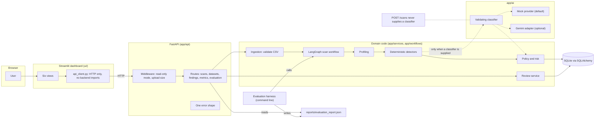
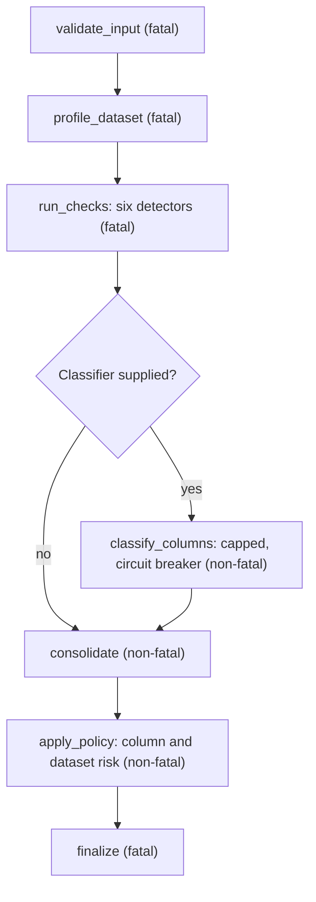
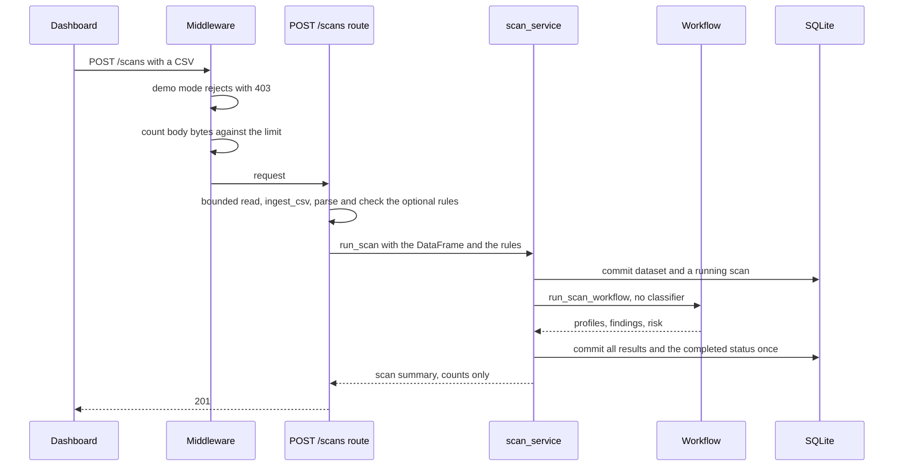
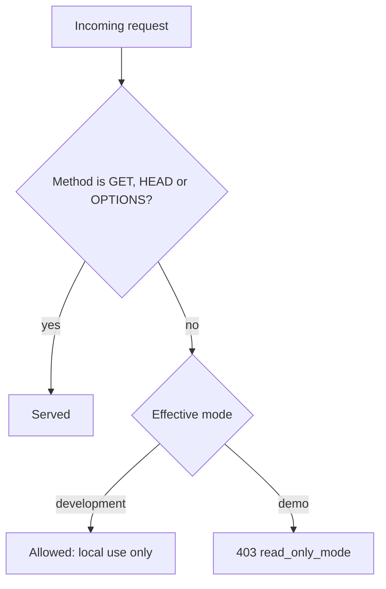
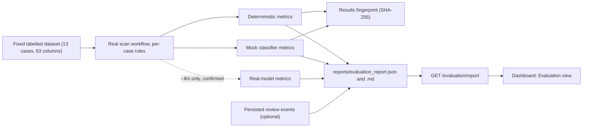

# VerityGrid architecture

This document describes what is built, not what was planned. Diagrams are Mermaid, so they render on GitHub and in many Markdown viewers.

## 1. System overview

Solid arrows are always taken. Dashed arrows are optional: **no HTTP request can reach the classification path**, so the real-model adapter is used only by code that calls the workflow directly (the evaluation harness with `--llm`, or a script).

## 2. Layers and responsibilities

| Layer | Where | Responsibility |
|---|---|---|
| Presentation | `ui/` | Six dashboard views. An HTTP client only: it never imports backend code, opens the database or reads backend secrets. All report text is shown as plain text. |
| API | `app/api/` | Routes without business logic, one error shape, the read-only middleware, the upload-size middleware. |
| Ingestion | `app/services/ingestion.py` | Validates bytes: size, UTF-8, header rules, ragged rows, row and column limits. Returns a DataFrame; never writes to disk. |
| Profiling | `app/services/profiling.py` | Per-column type, row count, null and distinct shares. |
| Detection | `app/services/detectors.py` | Six deterministic detectors producing `DetectedFinding` objects with safe evidence only. |
| Orchestration | `app/workflows/scan_graph.py` | A bounded, acyclic LangGraph workflow that calls the services above. |
| AI | `app/ai/` | Provider interface, mock provider, validating classifier, optional Gemini adapter, factory. Advisory only. |
| Persistence | `app/db/`, `app/services/scan_service.py`, `review_service.py` | ORM models, sessions, transactions. |
| Evaluation | `app/evaluation/` | Fixed labelled dataset, metrics, harness, report. |

## 3. The scan workflow

(The decision node is conceptual: the step only runs when a classifier is passed in.)

- **Fatal steps** end the workflow with status `failed`; the scan is recorded as failed.
- **Non-fatal steps** leave the deterministic results intact and give status `partially_completed`.
- **Bounds:** at most 50 columns are classified per scan, classification stops after 3 consecutive provider failures, and the graph has a recursion limit of 20.
- **No hidden state:** the DataFrame is held in closures and never in graph state. Issues record a step, a stable code and an exception class name, never messages, values or column names.
- **Policy** can raise a column's risk or its review requirement, never lower what findings established, and never sets a review status. Only humans do.

## 4. An upload, end to end (development mode)

If anything fails after the first commit, the transaction is rolled back and the scan row is marked `failed` in a separate transaction; the API returns only a generic, data-free message.

## 5. Persistence

Six ORM tables, created with `create_all` (no migration tool):

| Table | Holds |
|---|---|
| `Dataset` | One row per upload: a trimmed name and the reduced file name. |
| `ScanRun` | Status, timestamps and a counts-only summary (plus a `workflow` block when classification ran or the workflow was not clean). |
| `ColumnProfile` | Per-column statistics and, when classified, the label, its source (`mock`, `llm` or `none`) and the explanation. |
| `Finding` | Category, severity, detection method, title, description, safe evidence, review status. Never a cell value. |
| `ReviewDecision` | Append-only approve or reject history, with an optional comment and a self-reported reviewer name. |
| `AuditEvent` | One event per review: actor, event type, identifiers, categories, statuses and whether a comment exists, never the comment text. |

`Finding.review_status` always equals the latest decision. A review writes the decision, the status and the audit event in **one** commit, so a decision can never exist without its audit event. SQLite foreign keys are switched on for every connection.

## 6. The AI boundary

| Crosses to the provider | Never crosses |
|---|---|
| An opaque column reference (`col_N`), the sanitized column name (at most 64 characters), inferred type, row count, null and distinct shares, and per-column finding summaries (category, severity, scalar evidence) | Cell values, finding titles and descriptions, dataset-level findings, dataset names, file names |

- **Output is untrusted.** A provider returns a raw mapping that the classifier validates against a strict schema: the five labels, bounded text, at most 8 references, each a known shape and each one that was offered. Anything else becomes a fallback result (`unknown`, `review_required`, source `none`).
- **Provenance is set by the classifier**, not by the provider, so a provider cannot claim to be verified.
- **Policy floors:** `personal`, `financial` and `unknown` always need review; a non-personal label on a column with email or phone findings is raised to review-required with a note.
- **Bounded cost:** the adapter retries at most 3 times; the workflow caps columns and stops after repeated failures.
- **Results are labelled** "AI suggestion, unverified: a human must review it", and the mock is labelled a rule-based placeholder, not an LLM.

## 7. Access modes

The effective mode is `development` only when `VERITYGRID_MODE=development` **and** `ENVIRONMENT` is not `production` or `prod`; anything else, including a missing or invalid value, is `demo`. The check is the outermost middleware, so it runs before any body is read and covers routes that do not exist. It is deny-by-method, not authentication.

## 8. The evaluation pipeline

The fingerprint covers the dataset and the deterministic and mock metrics, and excludes timings, timestamps, real-model output and review data, so two runs on the same code must print the same value. The three sources of evidence are reported separately and never combined, and a successful classification must carry the expected provenance (`mock` or `llm`) or the harness raises.

## 9. Design decisions and trade-offs

- **Deterministic first, AI advisory.** Rules produce findings; the model only suggests a label that a human can ignore. This keeps results explainable and testable.
- **A thin web layer.** Routes contain no logic and let domain exceptions reach one set of handlers, which keeps error behaviour uniform.
- **The workflow is acyclic and bounded** because a scan is a pipeline, not an agent loop; unbounded loops would only add cost and failure modes.
- **A read-only public demo instead of access control**, because a shared token is not a user identity and would leave a public write API open to abuse.
- **The dashboard is an HTTP client** so the same API serves the UI, scripts and tests, and a UI bug cannot touch the database.
- **The API serves a generated report instead of running an evaluation**, so a web request can never start a batch job or cause a paid call.
- **SQLite and `create_all`** keep the prototype self-contained; the cost is no migrations and no serialisation of concurrent reviews on other databases.

## 10. What the architecture does not provide

No authentication or authorization, rate limiting, TLS, background jobs, multi-user accounts, row-level data access, remediation of any kind, or classification over HTTP. See the limitations in the [README](../README.md) and in [SECURITY.md](../SECURITY.md).